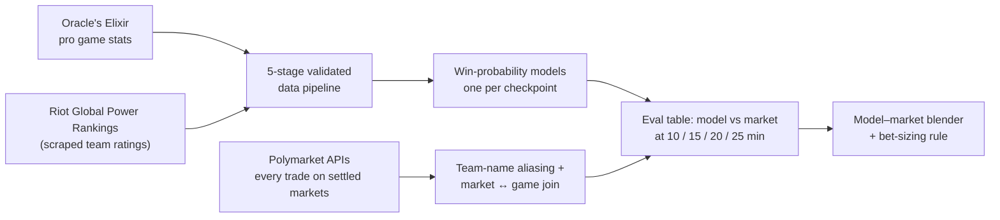

# Polyjuice

**Can a model that watches a League of Legends match beat the betting market on who will win it?**

Polyjuice is a research pipeline that predicts the winner of professional League of Legends games from the live game state at 10, 15, 20 and 25 minutes. It lines those predictions up against what Polymarket traders were paying at the same moments, and tests whether the difference is a real edge or a statistical illusion.

> Research and backtesting only. There is no execution layer, and nothing in this repo places bets.

## Highlights

- **Data at scale:** ~47,000 pro games (Oracle's Elixir, 2020–2026) and every trade (1M+) on 2,000+ settled Polymarket markets. About 90% of the markets are matched to the exact game they were betting on and aligned to the game clock.
- **A calibrated model:** on 2026 games it never trained on, it picks the winner 71% of the time at 10 minutes and 84% at 25, with an expected calibration error of 0.02–0.03.
- **An honest answer:** on its own, the model only ties the market. A blend of the two beat the market's own price on a chronological holdout (Brier score 0.104 vs 0.140; the 95% confidence interval on the difference excludes zero). The sample is small (29 games) and the edge is measured before fees and spread.
- **Methodology first:** chronological splits, measured leakage, acceptance gates committed before any results came in, bootstrap confidence intervals on the key comparisons, and 200+ tests.

## How it works



### 1. Data pipeline

Raw Oracle's Elixir data has 12 rows per game (10 players and 2 teams). Five stages turn it into one training table per checkpoint. Each stage is a pure `run()` function plus a `validate()` that asserts the stage's invariants before anything is written, so a bad transform stops the pipeline where it happens instead of quietly reaching training.

| Stage | What it does |
|---|---|
| 1. Load and filter | Complete data only, 2020–2026, leagues mapped to a tier (S/A/B, scraped from Liquipedia), exactly one winner per game |
| 2. One row per game | Keeps one randomly chosen side per game (fixed seed), so `side` is a learnable feature and the model answers "will *this* team win?", the same question a market asks |
| 3. Features | Gold, CS, kills and assists at each checkpoint, for the team, its opponent and the difference |
| 4. Split by checkpoint | One table per checkpoint, with first-event flags included only once those events have usually happened |
| 5. Team strength | Joins Riot's published team ratings, using only ratings published before the game started |

### 2. Keeping the future out of the training data

Much of the work went into making sure the model never learns from information it won't have live:

- **End-of-game totals.** Columns like `dragons` and `barons` are final counts. Measured against games that ended at each checkpoint, a 25-minute model using them would overcount barons by about 37%, so every cumulative count was dropped.
- **"First" events.** `firsttower` and `firstbaron` are also only known after the game. Measured on 293 games from the live stats feed, first tower has happened by minute 15 in only 22% of games, and first baron by minute 25 in only 19%. Each flag is now included only at checkpoints where it has usually already happened. Gating them this way cost about 0.016 Brier at 25 minutes, which is accuracy that had been coming from the leak.
- **Train/serve parity.** Anything the live feed can't supply (XP, heralds, void grubs, and Atakhan, an objective that existed only in 2025) is dropped, even where it helped in backtests.
- **Time.** Team ratings are joined with a strict "published before game start" rule in UTC. All splits are chronological, which also keeps games from the same series together.

### 3. Models

- **One model per checkpoint.** A 2,000-gold lead means something different at minute 10 than at minute 25, and four specialized models are easier to calibrate than one general model.
- **Chronological splits throughout.** The XGBoost-vs-baseline comparison used five slices: training through mid-2024, early stopping on late 2024, tuning on early 2025, an acceptance gate on late 2025, and **2026 held out as the test set**. The evaluation commands refuse to run again once results exist, so re-testing is always a deliberate act.
- **Logistic regression** as the baseline, against **XGBoost tuned with Optuna** (100 trials per checkpoint, isotonic calibration with a rule-based fallback to Platt scaling).
- **XGBoost had to beat the baseline by a margin committed in writing before any numbers came in. It failed at all four checkpoints, so logistic regression shipped.**

The logistic model on 2026 games that weren't in its training data (3,200–3,400 games per checkpoint):

| Checkpoint | Picks the winner | AUC | Brier (lower is better; 0.25 = coin flip) |
|---|---|---|---|
| 10 min | 71% | 0.79 | 0.187 |
| 15 min | 76% | 0.85 | 0.162 |
| 20 min | 80% | 0.89 | 0.136 |
| 25 min | 84% | 0.93 | 0.111 |

### 4. Model vs. market

**Collecting market data.** `dump_trades.py` pulls every fill from 2,038 settled "Game N Winner" markets across 880 events. It is built to survive a long run failing at any point. Progress is recorded in an append-only ledger, each market is written through a staging file, and a restart cleans up partial writes and skips finished markets. `verify_dump.py` then checks counts, duplicates and referential integrity, and spot-checks a market against the live API.

**Matching markets to games.** Polymarket names teams in free text ("FURIA Esports"), while Oracle's Elixir uses canonical names ("FURIA"). An alias map (198 exact matches, 16 resolved by hand, 4 deliberately left out) plus a join on date, team pair and game number matches about 90% of markets to their exact game. A timing audit over 1,478 markets checked that game start plus game length lines up with the moment each market resolved. The median offset was about one minute.

**Results** (2,300 market snapshots from 628 games):

1. **The model alone roughly ties the market.** Brier 0.151 vs 0.156, and the 95% confidence interval on the difference includes zero. The market is hard to beat.
2. **The model's edges point the right way but are about 1.7× too large.** Sizing bets on raw model edges would systematically over-bet.
3. **Blending fixes the sizing.** A per-checkpoint logistic blend, `logit(p) = a + b·logit(p_model) + c·logit(p_market)`, gives both inputs significant weight, because each carries information the other lacks. Its predicted edges match realized edges across the whole range.
4. **The blend holds up forward in time.** Fit on top-tier games through 2026-04-15, then scored on the 29 games played after that (113 snapshots):

   | | Brier |
   |---|---|
   | Market price | 0.140 |
   | Model alone | 0.143 |
   | **Blend** | **0.104** |

   The difference vs. the market is −0.036, with a 95% confidence interval of [−0.062, −0.009].
5. **Common ways backtests go wrong were checked:**
   - **Stale prices:** ruled out. The last trade was typically 2–3 seconds old.
   - **Endgame sniping:** ruled out. At 25 minutes, the edge grows when snapshots within 5 minutes of the end are excluded.
   - **Timing noise:** ruled out. Tighter time alignment made the edge bigger, not smaller.

**Resulting v1 rule:**
- Bet only on top-tier leagues.
- Bet when the blend disagrees with the market by at least 10 percentage points.
- Size with quarter-Kelly, capped at 2% of bankroll.
- Log every bet, and re-check calibration after 50 bets.

## What didn't work

- **XGBoost.** Tuned and calibrated, it still never beat logistic regression on the acceptance set (25-minute log-loss 0.284 vs 0.277, for example). The gate turned "the fancier model should be better" into a measurable question, and the answer was no.
- **Riot's team-strength ratings (GPR).** On top-tier 2026 games they improved log-loss by 0.007, which is not statistically significant, and calibration got slightly worse. They were kept for top-tier games because the model's probabilities are sharper with them. That was a judgment call, and it is documented as one.

## Limitations

- **Small final sample.** The final blend was fit on 142 games, and the forward test covered only 29. The confidence interval excludes zero, but that is a first result, not a track record.
- **Paper prices.** Market prices are last trades, not the bid/ask you could actually get, and all edges are before spread and fees.
- **Filters chosen in-sample.** The top-tier filter and the 60-second timing filter were picked during the same research window as the test period. Live results are the real test.
- **Unofficial live data.** The live game feed is an unofficial lolesports API with no SLA.

## Repository map

```
scripts/preprocess/     5-stage pipeline; each stage validates its own output
scripts/models/         logistic baseline, XGBoost + Optuna, and their team-rating variants
scripts/gpr/            Riot Global Power Rankings scraper + team-name aliases
scripts/polymarket/     trade dump, dump verifier, alias map, market ↔ game join, eval table
scripts/exploration/    50 numbered analysis scripts; their outputs are in data/exploration/
docs/specs/             written specs for the main components
discovery-checklist.md  every modeling decision, with the evidence and reasoning behind it
tests/                  pytest suite on synthetic fixtures
```

## Running it

Requires Python 3.10+. The tests run on synthetic fixtures, so no data download is needed:

```bash
pip install pandas numpy scikit-learn "xgboost>=3.2,<4" "optuna>=3.0,<5" statsmodels matplotlib pytest
python -m pytest tests/
```

The raw data isn't redistributed. To rebuild everything, download the yearly CSVs from [Oracle's Elixir](https://oracleselixir.com/tools/downloads) into `data/lol-historical-data/`, then run:

```bash
python -m scripts.gpr.scrape --refresh                       # team ratings from lolesports.com
python scripts/build_dataset.py                              # pipeline stages 1-5
python -m scripts.models.baseline_logistic_gpr               # fit + validate
python -m scripts.models.baseline_logistic_gpr --fit-production

python scripts/polymarket/dump_trades.py                     # long run, safe to interrupt and resume
python scripts/polymarket/build_alias_map.py
python scripts/polymarket/join_oe.py
python scripts/polymarket/build_eval_table.py
python scripts/exploration/49_pmoe_date_anchor_full.py       # market-timing audit
python scripts/exploration/51_pmoe_blender_fit_production.py # fit the model-market blender
```

## How it was built

Built over about two and a half weeks in April–May 2026, with Claude Code as the coding agent and a research-first workflow:

- Open questions and decisions are tracked in `discovery-checklist.md`, each with the evidence behind it.
- The main components have written specs with acceptance criteria in `docs/specs/`.
- Every analysis script saves its output to `data/exploration/`, so the numbers in this README trace back to files in the repo.

---

Data: [Oracle's Elixir](https://oracleselixir.com) (game stats), [Polymarket](https://polymarket.com) public APIs (prices), and [LoL Esports Global Power Rankings](https://lolesports.com) (team ratings). Not affiliated with Riot Games, Oracle's Elixir or Polymarket.
